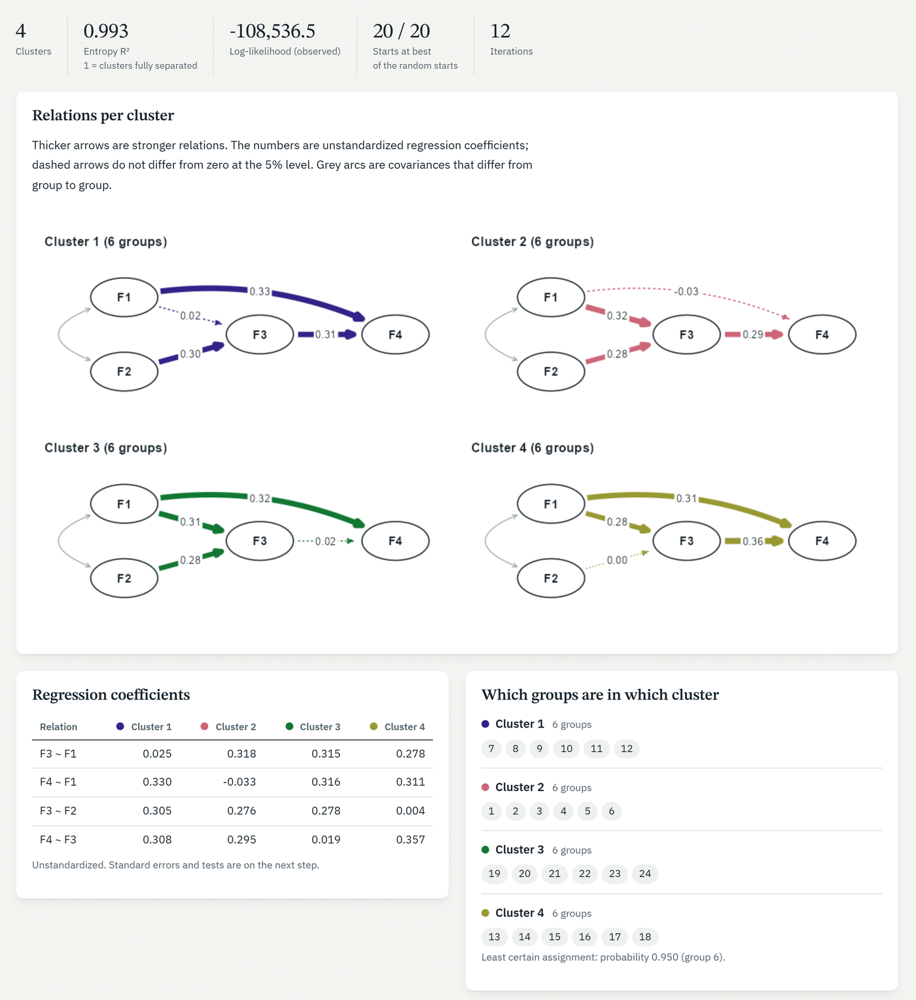

# mmgsemGUI

A point-and-click interface for Mixture Multigroup Structural Equation Modeling
(MMG-SEM) with the [`mmgsem`](https://github.com/AndresFPA/mmgsem) R package
(Perez Alonso, Vermunt, Rosseel, Zhao & De Roover, 2026,
<https://doi.org/10.1080/10705511.2026.2617170>).

MMG-SEM clusters groups, such as countries, on the relations between their
latent variables while accounting for measurement non-invariance. mmgsemGUI
guides you through such an analysis in eight steps, from opening the data to
testing hypotheses. All estimation is done by `mmgsem` and `lavaan`; the
interface adds background computation, diagnostics, graphics, and an R script
that reproduces every analysis.



## Install

**Windows, without R.** Download `mmgsemGUI-setup-<version>.exe` from the
[Releases](../../releases) page and run it. It installs the application
together with R and all packages for the current user, without administrator
rights. The installer is not signed, so Windows asks for confirmation before
it starts.

**With R (4.1 or later), on any system.**

```r
install.packages("pak")
pak::pak("cahitgs/mmgsemGUI/mmgsemGUI")   # also installs mmgsem at the tested version
mmgsemGUI::run_app()
```

The interface opens in the browser but runs on your own computer: no data
leave it and no internet connection is needed.

## The steps

1. **Data**: a file with one row per respondent, one column per item, and a
   grouping variable, or the example of the mmgsem tutorial.
2. **Measurement model**: factors and their items, loadings released across
   groups, optionally FIML, measurement blocks, or ordinal items.
3. **Structural model**: the regressions between the factors.
4. **Number of clusters**: several solutions estimated in parallel and
   compared on six criteria.
5. **Clusters and relations**: path diagrams per cluster, coefficients,
   cluster membership.
6. **Hypothesis tests**: standard errors, z tests, Wald tests, pairwise
   comparisons.
7. **Describe the clusters**: compare a group-level variable across clusters.
8. **R script and files**: the script of the analysis, result tables, and a
   project file.

The [README of the package](mmgsemGUI/README.md) documents the steps, how the
interface was validated against `mmgsem` and the tutorial, and its safeguards.

## What is in this repository

| Folder | Content |
|---|---|
| `mmgsemGUI/` | The R package: interface, computation, and tests |
| `installer/` | The script and Inno Setup file that build the Windows installer |

## Tests

```r
# in the folder mmgsemGUI; set NOT_CRAN=true to include the estimation tests
testthat::test_local()
```

## Citation

Please cite the method and the estimation package:

Perez Alonso, A. F., Vermunt, J., Rosseel, Y., Zhao, H., & De Roover, K. (2026).
Using mixture multigroup structural equation modeling to compare structural
relations across many groups: An introduction to the mmgsem R package.
*Structural Equation Modeling: A Multidisciplinary Journal, 33*(5), 803–830.
<https://doi.org/10.1080/10705511.2026.2617170>

## License

MIT; see [LICENSE](LICENSE). The installer bundles R and R packages, which keep
their own licences.
